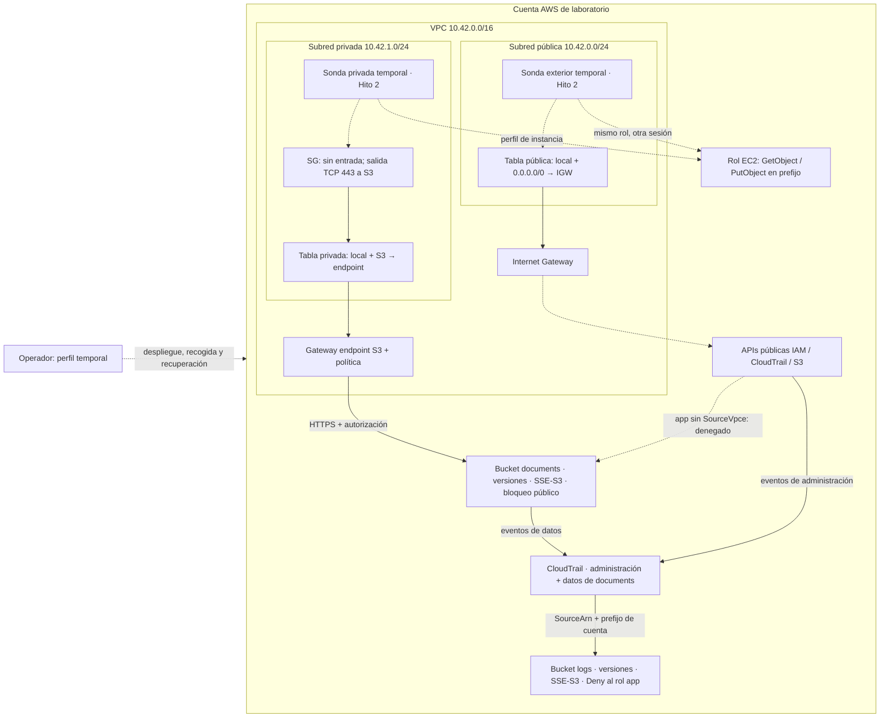

# Arquitectura y decisiones

## Diagrama

Las líneas discontinuas indican componentes opcionales del Hito 2, implementados
en `probes.tf` y desactivados por defecto. S3 y CloudTrail son servicios regionales/globales,
no componentes instalados dentro de las subredes.

## Red y autorización

La tabla pública tiene una ruta explícita al IGW. La privada solo conserva la
ruta local automática y la ruta de S3 que AWS instala al asociar el gateway
endpoint. Ambas subredes tienen asociación explícita; no dependen de la tabla
principal. El gateway endpoint evita NAT e interfaces PrivateLink facturadas.
Su destino es la lista de prefijos de S3 de la misma región.
[Integración oficial de S3 y VPC](https://docs.aws.amazon.com/vpc/latest/privatelink/vpc-endpoints-s3.html).

El SG de aplicación no admite conexiones entrantes y solo permite TCP 443 hacia
esa lista. Es stateful: el tráfico de respuesta no requiere una regla de entrada.
El gateway endpoint no tiene SG propio. No configuramos IPv6. Las NACL por defecto
permanecen permisivas y no se presentan como un control adicional. El SG por
defecto de la VPC no se asignará a las sondas. El tráfico local de la VPC sigue
teniendo ruta; el SG limita sus conexiones.

El resolver DNS de VPC y los servicios locales como IMDS tienen excepciones a
los filtros de SG. La sonda utiliza DNS e IMDSv2 sin necesitar STS por internet
para obtener el perfil EC2. No afirmamos aislamiento absoluto ni protección
contra exfiltración por DNS. [Limitaciones de los SG](https://docs.aws.amazon.com/vpc/latest/userguide/vpc-security-groups.html).

Los cuatro controles son distintos: política IAM, rutas, SG y políticas de
endpoint/bucket. Un timeout no acredita `AccessDenied`. La política del endpoint
no concede permisos por sí sola, ni impide acceder al endpoint público de S3
desde otro lugar. Por eso el bucket deniega al rol app cuando `aws:SourceVpce`
no corresponde al endpoint del laboratorio. El operador no está sujeto a esa
denegación y puede recuperar objetos o desmontar desde fuera.
[Condición de origen](https://docs.aws.amazon.com/AmazonS3/latest/userguide/example-bucket-policies-vpc-endpoint.html).

## IAM y S3

`GetObject` y `PutObject` son suficientes para claves conocidas y objetos pequeños
mediante `s3api`. No se concede `ListBucket`, `DeleteObject`, `DeleteObjectVersion`,
`GetObjectVersion`, administración de bucket, IAM ni CloudTrail. Para un catálogo
de documentos habría que justificar y probar `ListBucket` con `s3:prefix`.
El `/` final evita que `app/documents-old/` coincida por accidente.

La confianza permite únicamente al servicio EC2 asumir el rol. El operador debe
limitar `iam:PassRole` a este perfil/rol y a EC2; quien pueda asociarlo a otra
instancia podrá obtener una sesión. No se añade confianza de usuario, cuenta
completa ni STS arbitrario. `Principal: "*"` en una **denegación** de bucket no
otorga acceso público. En el **Allow** del endpoint se combina con `ArnEquals`
al ARN exacto del rol; no es la política de confianza.

Los buckets tienen las cuatro protecciones de acceso público, ACL deshabilitadas
y SSE-S3 predeterminado. Se evita una clave KMS adicional y sus permisos/costes:
el objetivo es delimitar acceso a objetos. El cifrado en reposo no sustituye a
IAM. El Deny de HTTP excluye principales de servicios AWS para no interferir en
entregas donde se omiten atributos de transporte.
[Claves de condición S3](https://docs.aws.amazon.com/AmazonS3/latest/userguide/amazon-s3-policy-keys.html).

Ambos buckets tienen versionado. Sobrescribir crea otra versión; el rol app no
puede eliminar la anterior. No hay caducidad automática de objetos/evidencias,
Object Lock ni promesa de inmutabilidad. `force_destroy = false` exige vaciar de
forma deliberada. Un administrador todavía puede alterar políticas o borrar
versiones. `PutObject` también autoriza fases de multipart: el guion usa objetos
pequeños, pero un atacante podría acumular cargas incompletas y costes.

## Auditoría

Un trail multirregión recoge administración de lectura/escritura e incluye
servicios globales como IAM. Los datos se limitan al ARN del bucket de documentos
con `/` final, no solo al prefijo permitido: interesa observar intentos sobre
otros prefijos. No se incluyen datos del bucket de logs, Insights, Lake, CloudWatch
Logs, eventos de red ni Flow Logs en esta entrega.

CloudTrail puede comprobar la ACL y escribir en `AWSLogs/<account-id>/*` con
`bucket-owner-full-control` y `aws:SourceArn` del trail. El ARN se construye con
variables para evitar un ciclo Terraform entre trail y política. La creación del
trail espera a política, cifrado y versionado. El bucket deniega `s3:*` al rol
app incluso si posteriormente se ampliaran sus permisos IAM.
[Entrega oficial de CloudTrail](https://docs.aws.amazon.com/awscloudtrail/latest/userguide/create-s3-bucket-policy-for-cloudtrail.html).

Los digests permiten verificar integridad tras su entrega; no impiden borrar ni
verifican automáticamente los logs. La protección cubre credenciales app
comprometidas, no el compromiso administrativo de toda la cuenta.
