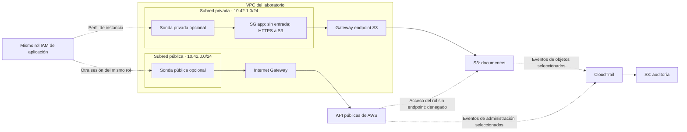

# Cloud Security Architecture Lab: explicación del proyecto y su implementación

## 1. En qué consiste

Cloud Security Architecture Lab es un laboratorio de seguridad en AWS definido
mediante código. Su objetivo es estudiar cómo limitar los permisos de una
aplicación, restringir sus comunicaciones y proteger los registros que permiten
investigar su actividad.

El escenario representa una aplicación que trabaja con documentos almacenados
en Amazon S3. Puede leer y escribir objetos dentro de `app/documents/`, incluidas
sobrescrituras, pero su política no concede permiso para listar el bucket,
borrar documentos, acceder a otros prefijos, administrar identidades o modificar
la auditoría.

La carga de trabajo se representa con **sondas de prueba en Python**: programas
que realizan operaciones concretas y registran sus resultados. El proyecto
incluye la infraestructura y esas sondas, sin una interfaz web de gestión de
documentos.

**Estado de la entrega:** el código y la documentación están terminados para
su uso y validación local. Los resultados de cierre documentados incluyen
14 escenarios Terraform y 20 pruebas Python aprobados. No se ha desplegado el
laboratorio en AWS ni ejecutado allí la matriz de pruebas reales.

## 2. Qué problema de seguridad plantea

El modelo de amenazas supone que un atacante obtiene una sesión temporal válida
del rol de la aplicación o consigue ejecutar código dentro de su instancia.
El atacante no controla la cuenta completa ni los permisos del operador que
administra Terraform.

La pregunta que guía el diseño es: **¿qué podría hacer ese atacante con los
permisos y la conectividad de la aplicación?** Para responderla se relacionan
amenazas, controles, pruebas y evidencias.

| Riesgo estudiado | Respuesta implementada |
| --- | --- |
| Leer o escribir documentos de otras áreas | Permisos IAM y política del endpoint limitados al prefijo autorizado |
| Borrar documentos o versiones anteriores | La política de aplicación no concede borrado ni acceso a versiones; se configura versionado |
| Usar el rol desde otra ubicación de red | El bucket de documentos exige al rol el endpoint concreto del laboratorio |
| Exponer objetos públicamente | Bloqueo de acceso público, ACL deshabilitadas y política de transporte seguro |
| Leer o alterar registros de auditoría | Bucket separado con denegación explícita para el rol de aplicación |
| Modificar IAM o CloudTrail | La política de aplicación concede únicamente dos acciones S3 |
| Abrir conexiones entrantes o salir libremente a internet | Rutas y reglas de red específicas para la sonda privada |

La separación entre aplicación y operador es deliberada. La aplicación realiza
operaciones sobre documentos; el operador prepara pruebas, recupera versiones,
recoge evidencias y administra el ciclo de vida del laboratorio.

## 3. Tecnologías utilizadas

| Tecnología | Papel dentro del proyecto |
| --- | --- |
| Terraform y HCL | Definir recursos, relaciones, variables, políticas y comprobaciones de infraestructura |
| Amazon VPC | Separar ubicaciones de red y definir rutas de comunicación |
| Amazon S3 | Almacenar documentos y registros en buckets distintos |
| AWS IAM | Definir el rol de aplicación, su confianza y sus permisos |
| AWS CloudTrail | Configurar la recogida de eventos y la generación de digests de integridad |
| Amazon EC2 | Alojar las sondas temporales cuando se autorice una ejecución real |
| Python y su biblioteca estándar | Implementar sondas, clasificación de resultados, lectura de consola y validación local |
| Bash y cloud-init | Preparar y ejecutar las sondas al arrancar las instancias |
| AWS CLI v2 | Realizar las llamadas de las sondas a las API de AWS |
| GitHub Actions | Ejecutar automáticamente el comprobador local al publicar el repositorio |

La configuración permite Terraform `>= 1.7, < 2.0`. La versión fijada para el
entorno reproducible es **1.14.9**, y el lockfile registra el proveedor AWS
**6.66.0**. Python requiere la versión 3.9 o posterior. La validación local no
necesita AWS CLI, cuenta ni credenciales; las sondas reales sí necesitan CLI v2
precargada en su imagen.

## 4. Arquitectura propuesta

La configuración utiliza por defecto una VPC `10.42.0.0/16` en `eu-west-1`.
De ella se derivan dos subredes `/24`, cada una con una tabla de rutas asociada
explícitamente.



El diagrama representa la configuración preparada para AWS. Las sondas están
desactivadas por defecto. S3 y CloudTrail son servicios externos a las subredes;
el diagrama no implica que estén instalados dentro de la VPC ni que todas las
peticiones rechazadas produzcan un evento en el trail.

La subred pública tiene una ruta `0.0.0.0/0` hacia el Internet Gateway. La privada
no tiene una ruta por defecto a internet ni un NAT Gateway: su acceso a S3 se
define mediante un **gateway endpoint**, asociado únicamente a su tabla de rutas.

El security group de aplicación no define entrada y solo permite salida TCP 443
hacia la lista regional de prefijos de S3. El diseño conserva las excepciones
de AWS para servicios como DNS de VPC y metadatos de instancia; no presenta esta
configuración como aislamiento absoluto o protección completa contra exfiltración.

## 5. Cómo se ha implementado la infraestructura

### 5.1. Organización y configuración

Los archivos `.tf` de la raíz forman una única configuración Terraform. La
separación por archivos permite revisar cada responsabilidad sin duplicar
recursos.

| Archivo | Responsabilidad |
| --- | --- |
| [versions.tf](../versions.tf) | Restricciones de versiones, proveedor, región, cuenta esperada y etiquetas comunes |
| [variables.tf](../variables.tf) | Entradas y validaciones de cuenta, región, nombres, prefijo y red |
| [locals.tf](../locals.tf) | Valores derivados, ARN de recursos y nombre del trail |
| [network.tf](../network.tf) | VPC, subredes, tablas, rutas, Internet Gateway, endpoint S3 y SG app |
| [iam.tf](../iam.tf) | Rol, confianza EC2, perfil de instancia y políticas de aplicación y endpoint |
| [storage.tf](../storage.tf) | Dos buckets y sus controles y políticas |
| [audit.tf](../audit.tf) | Trail y selección de eventos |
| [probes.tf](../probes.tf) | Instancias opcionales, selección de AMI, bootstrap y red de comparación pública |
| [outputs.tf](../outputs.tf) | Identificadores de red, almacenamiento, aplicación y auditoría |

`probes.tf` añade además el output `probes`, con los identificadores de instancias,
la IP privada y el ID de ejecución. El archivo
[terraform.tfvars.example](../terraform.tfvars.example) muestra las entradas
esperadas con valores ficticios.

El proveedor utiliza `allowed_account_ids` para limitar las operaciones reales
a la cuenta indicada. Los nombres de buckets se reciben como variables, y el
prefijo autorizado debe terminar en `/`, no admite comodines y reserva
`restricted/` y `probe-fixtures/` para las pruebas negativas.

### 5.2. Permisos mínimos de la aplicación

La política de aplicación se construye como un objeto HCL y se serializa con
`jsonencode`. Con el prefijo por defecto, el permiso se limita a este patrón:

```text
Acciones: s3:GetObject y s3:PutObject
Recurso:  arn:aws:s3:::<bucket-documentos>/app/documents/*
```

La aplicación trabaja con claves conocidas, por lo que no necesita listar el
bucket. El `/` final del prefijo también evita confundir `app/documents/` con
`app/documents-other/`.

El rol confía exclusivamente en el servicio EC2 y se asocia a las instancias
mediante un perfil. Las sondas no reciben claves estáticas guardadas en el código.

Hay controles en varias capas, cada uno con una función distinta:

1. **IAM:** limita las acciones y los objetos autorizados para el rol.
2. **Red:** define los caminos disponibles y las conexiones permitidas.
3. **Política del endpoint:** restringe las peticiones que atraviesan ese endpoint
   al rol, las acciones y el prefijo previstos.
4. **Política del bucket:** deniega al rol de aplicación las solicitudes que no
   provienen del endpoint concreto mediante `aws:SourceVpce`.

Esta última denegación permite estudiar el uso del mismo rol desde otra red.
No se aplica de igual forma al operador, que necesita recuperar documentos y
administrar el laboratorio desde su entorno autenticado.

### 5.3. Protección de documentos y registros

Los dos buckets tienen bloqueo de acceso público completo, ACL deshabilitadas
con `BucketOwnerEnforced`, cifrado predeterminado SSE-S3 con AES256 y versionado.
Sus políticas incluyen una denegación de transporte inseguro con una excepción
para principales de servicios AWS.

El bucket de auditoría añade un `Deny` explícito de `s3:*` para el rol app.
CloudTrail dispone de permisos de entrega separados, limitados al ARN del trail
y al prefijo de la cuenta.

Se ha permitido sobrescribir documentos de forma intencionada. El versionado
conserva versiones anteriores para una recuperación del operador; no evita que
la aplicación escriba contenido falso en la versión actual. Tampoco se configura
Object Lock ni se promete inmutabilidad frente a un administrador de cuenta.

Ambos buckets utilizan `force_destroy = false`. Un futuro desmontaje exige
vaciar deliberadamente versiones, marcadores de borrado y cargas multipart.

### 5.4. Auditoría

El trail se configura como multirregión, incluye eventos de servicios globales
y de administración de lectura y escritura, y selecciona eventos de objetos
del bucket de documentos completo. Así se pretende observar tanto las operaciones
autorizadas como los intentos sobre otros prefijos que lleguen a registrarse.

Los registros se entregan al bucket separado. La generación de digests queda
activada para una futura validación de integridad; esa validación y la correlación
de eventos corresponden al operador y todavía no se han realizado en AWS.

Para evitar un ciclo de dependencias entre el trail y su política de entrega,
su ARN se construye a partir de cuenta, región y nombre. La creación del trail
espera a la política, el cifrado y el versionado del bucket de registros.

## 6. Cómo se han implementado las sondas

Las sondas son instancias EC2 temporales cuya activación requiere una decisión
explícita. `enable_probes` activa la privada; `enable_public_probe` añade después
la pública. Se exige una AMI fijada por ID y un `probe_run_id` para correlacionar
objetos, resultados y evidencias.

La AMI se filtra por propietario Amazon, familia estándar Amazon Linux 2023,
arquitectura x86_64, virtualización HVM y raíz EBS. Las dos instancias se definen
como `t3.micro`, con créditos CPU `standard`, raíz gp3 de 8 GiB cifrada y borrado
del volumen al terminar. Requieren IMDSv2 con hop limit 1 y no configuran claves
SSH ni permisos SSM para la aplicación.

| Programa | Comportamiento implementado |
| --- | --- |
| [private_probe.py](../scripts/private_probe.py) | Escritura y lectura autorizadas, comparación de contenido y SHA-256, sobrescritura con VersionId distinto, intentos fuera del prefijo, listado, borrado, versiones y auditoría; controles de salida de red |
| [public_probe.py](../scripts/public_probe.py) | Identidad STS, acceso a documentos fuera del endpoint, intentos sobre auditoría, creación de un rol canario, actualización del trail y controles de red |
| [probe_common.py](../scripts/probe_common.py) | Argumentos, identidad por metadatos, entorno de CLI, límites de tiempo, clasificación y emisión de JSON |

La privada también inicia un listener TCP 8080 con un control local de conexión
y una duración de 25 minutos. La pública intenta conectarse a él mientras sigue
activo. Su SG permite esa salida únicamente hacia la IP privada `/32` de la sonda,
y el SG privado mantiene la entrada cerrada.

Cada programa exige `--execute`. Antes de las pruebas verifica cuenta, región
y rol mediante metadatos, y comprueba la presencia de AWS CLI v2. El entorno de
CLI elimina credenciales, perfiles, proxies y endpoints alternativos heredados,
para utilizar la sesión del perfil EC2 previsto. Las llamadas S3 fijan el
endpoint HTTPS regional y el propietario esperado del bucket.

La clasificación diferencia `allowed`, `denied` y `error`. Un `AccessDenied`
explícito puede acreditar un rechazo de autorización; un timeout, un fallo DNS,
un token caducado o una respuesta inválida no se convierten en ese resultado.
Las observaciones de bloqueo de red requieren controles adicionales del operador
para atribuir su causa.

### Entrega del código y recogida de resultados

[probe_bootstrap.sh.tftpl](../scripts/probe_bootstrap.sh.tftpl) empaqueta los tres
módulos en base64 dentro de un script de arranque. Terraform comprime el script
con gzip y lo entrega mediante `user_data_base64`. Una precondición comprueba el
límite de tamaño configurado. El arranque no instala paquetes ni descarga código.

El bootstrap programa un apagado a los 30 minutos y ejecuta Python sin buffer
con salida a `/dev/console`. El apagado limita la actividad, pero deja pendiente
la terminación de EC2 y la eliminación del volumen por el operador.

Los resultados son líneas JSON con ubicación, instancia, ID de ejecución y hora
UTC. Incluyen un resumen final y los identificadores necesarios para relacionar
subpruebas y versiones, sin imprimir el contenido de las credenciales.

[read_console.py](../scripts/read_console.py) procesa offline la consola exportada.
Acepta texto o una respuesta JSON con salida en texto/base64; comprueba la identidad
esperada, el resumen final y la presencia de subpruebas. Rechaza mezclas de
identidades y resúmenes contradictorios. Un informe completo de sonda todavía
necesita controles independientes y correlación con CloudTrail; el lector no
autentica al emisor ni sanea el informe para publicarlo.

## 7. Cómo se ha comprobado localmente

La validación está dividida entre los contratos de infraestructura y las pruebas
del código Python.

En [security.tftest.hcl](../tests/security.tftest.hcl), `mock_provider "aws"`
sustituye el proveedor real. Los 14 escenarios comprueban las políticas generadas,
la red, los buckets, CloudTrail, las sondas desactivadas por defecto y sus
configuraciones opcionales. También verifican el rechazo de entradas inseguras
o incompletas. Un `command = apply` dentro de estas pruebas se aplica al proveedor
simulado y no crea infraestructura AWS.

Las 20 pruebas Python sustituyen CLI, metadatos y conexiones de red cuando
ejercitan las sondas. Cubren recorridos completos, contenido corrupto, falta de
VersionId, permisos inesperados, fallos del cliente, selección de credenciales
y consolas incompletas o inconsistentes.

El cierre local también documenta la inspección del bootstrap generado por los
escenarios simulados: descompresión, comprobación de sintaxis con `bash -n` y
comparación de los módulos empaquetados con las fuentes.

El detalle de los resultados históricos y sus límites está en
[validación](validation.md). Estos resultados verifican la configuración y el
comportamiento simulado; no demuestran autorización efectiva, conectividad,
arranque de la AMI o entrega de eventos en AWS.

## 8. Automatización y uso local

[validate.py](../scripts/validate.py) reúne el recorrido de comprobación:

1. Registrar la versión de Terraform y comprobar el formato.
2. Inicializar con `-backend=false -input=false -lockfile=readonly`.
3. Ejecutar `terraform validate` y las pruebas Terraform con mocks.
4. Ejecutar las pruebas Python y revisar los enlaces Markdown locales.
5. Guardar logs e informe con UTC, códigos de salida y hashes SHA-256 de fuentes
   en `artifacts/local/`.

Desde la raíz del proyecto, con Terraform disponible en PATH:

```bash
rtk proxy python3 scripts/validate.py
```

Si el binario está en otra ubicación:

```bash
rtk proxy python3 scripts/validate.py --terraform /ruta/al/terraform
```

`rtk proxy` corresponde a las instrucciones de este entorno; en otros equipos
puede ejecutarse directamente `python3 scripts/validate.py`. La primera
inicialización necesita acceso al registro de proveedores.

El comprobador elimina la selección de credenciales AWS de su entorno hijo y
deshabilita IMDS. La opción `-backend=false` por sí sola solo omite inicializar
un backend y no convierte un `plan` o `apply` real en una operación offline.

El [workflow de GitHub Actions](../.github/workflows/validate.yml) ejecuta el mismo
comprobador en push, pull request o activación manual. Configura permisos de
lectura del repositorio, acciones fijadas por commit y Terraform 1.14.9, sin
credenciales AWS. Sus ejecuciones se consultan en
[GitHub Actions](https://github.com/mariaig01/cloud-security-architecture-lab/actions/workflows/validate.yml)
y se distinguen de las evidencias de validación local.

## 9. Reproducibilidad, costes y ciclo de vida

La versión de Terraform se registra en `.terraform-version` y la resolución
del proveedor en `.terraform.lock.hcl`. Las variables y los outputs permiten
configurar el laboratorio sin introducir identificadores reales en el código.
Estado, planes, credenciales y evidencias sin sanear están excluidos de Git.
La configuración utiliza estado local y no crea un backend remoto.

El diseño evita NAT Gateway y endpoints de interfaz, y mantiene EC2 desactivado
por defecto. Una ejecución real puede generar gasto por instancias, EBS, IPv4
pública, S3 y CloudTrail. El apagado programado no elimina todos esos costes.
La [guía de costes](costs.md) describe los supuestos para estimarlos sin afirmar
que el laboratorio sea gratuito.

La [guía de operación](deployment.md) prepara el recorrido posterior: revisar
cuenta y planes, crear objetos sintéticos de control, ejecutar sondas por fases,
recoger evidencias, correlacionar eventos, comprobar digests y desmontar.
El desmontaje contempla versiones, marcadores y multipart, además del inventario
final de recursos y de cualquier evidencia retenida.

## 10. Alcance terminado y comprobaciones pendientes

| Parte del trabajo | Estado documentado |
| --- | --- |
| Diseño, amenazas e infraestructura Terraform | Implementados |
| Sondas y lector de consola | Implementados y probados con simulación |
| Comprobador local y documentación operativa | Terminados |
| Contratos Terraform y pruebas Python | 14 y 20 aprobados en el cierre local documentado |
| Workflow CI | Configurado en GitHub; resultados disponibles por ejecución y commit |
| Despliegue y matriz P01–P23 en AWS | Pendientes, fuera del alcance local acordado |
| Correlación CloudTrail, digests, factura y desmontaje real | Pendientes de una futura ejecución AWS |

El proyecto permite explicar y revisar una arquitectura de permisos mínimos,
restricciones de red, separación de auditoría y comprobaciones reproducibles.
Los riesgos residuales también están documentados: una sesión app comprometida
conserva acceso a los documentos permitidos, puede sobrescribirlos y generar
gasto; un administrador comprometido queda fuera de la protección del modelo.

Para ampliar cada parte, consultar el [modelo de amenazas](threat-model.md), la
[arquitectura detallada](architecture.md), la [matriz de pruebas](test-matrix.md)
y el [plan de hitos](../PLAN.md).
